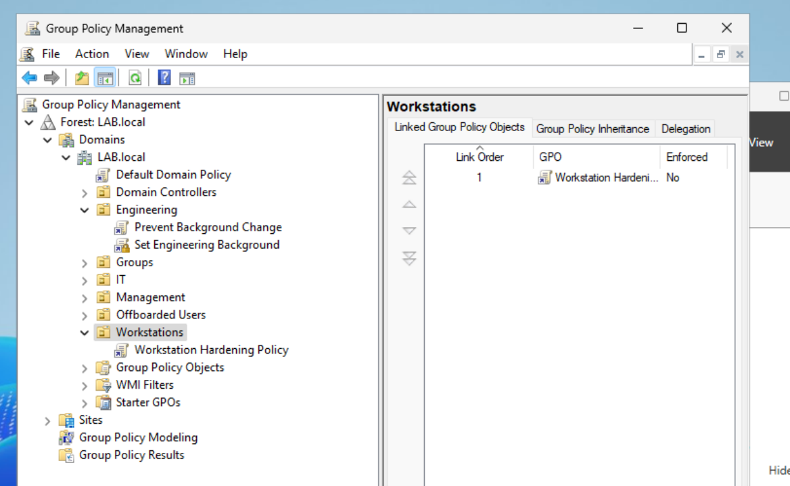
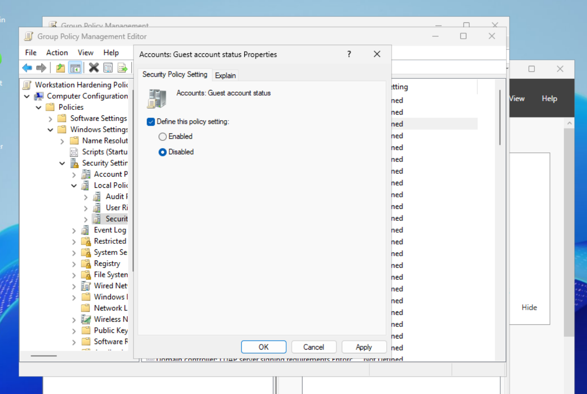
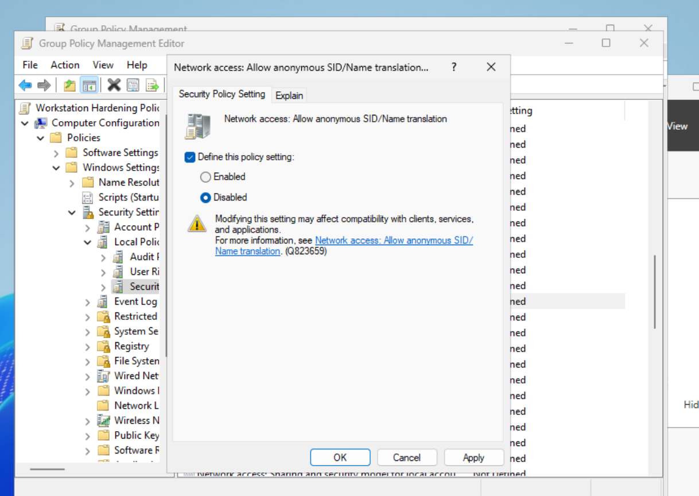
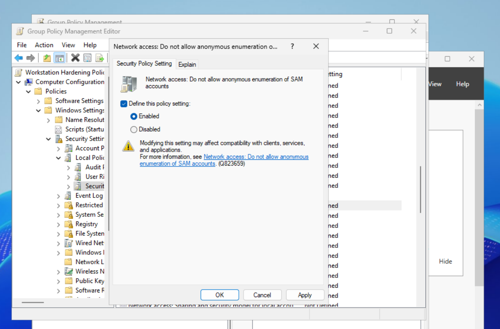
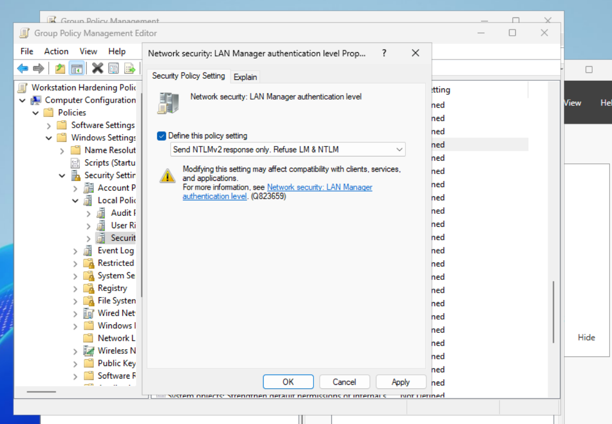
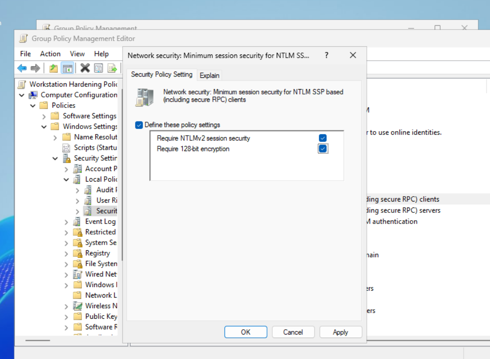
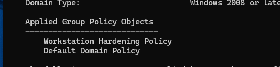

# AD-006 — Group Policy Workstation Hardening

## Project Overview

This project demonstrates how Group Policy can be used to centrally apply security hardening settings to Windows domain-joined workstations.

A dedicated `Workstations` Organizational Unit was created, the domain workstation `WS01` was moved into that OU, and a new Group Policy Object named `Workstation Hardening Policy` was linked directly to it.

The policy was used to strengthen local account security, reduce anonymous enumeration, and enforce stronger NTLM authentication settings.

The completed policy was then applied and validated from the domain-joined workstation using `gpupdate` and `gpresult`.

---

## Environment

- **Domain:** `LAB.local`
- **Domain Controller:** `DC01`
- **Domain-Joined Workstation:** `WS01`
- **Virtualization:** VirtualBox
- **Directory Services:** Active Directory Domain Services
- **Management Tool:** Group Policy Management
- **Target OU:** `Workstations`
- **GPO:** `Workstation Hardening Policy`

---

## Technologies Used

- Active Directory Domain Services
- Group Policy Management
- Group Policy Objects
- Windows Server
- Windows 11
- Active Directory Users and Computers
- Windows Security Policy
- `gpupdate`
- `gpresult`
- VirtualBox

---

# Scenario

An organization wants to establish a basic security baseline for domain-joined Windows workstations.

Applying security settings individually to each computer would create inconsistent configurations and unnecessary administrative work.

The objective of this project was to use Group Policy to centrally configure workstation security settings and verify that the policy successfully applied to a domain-joined endpoint.

---

# Project Goals

The workstation hardening project needed to:

1. Create a dedicated Organizational Unit for domain workstations
2. Move `WS01` into the new Workstations OU
3. Create a workstation-specific Group Policy Object
4. Link the GPO only to the Workstations OU
5. Disable the built-in Guest account
6. Disable anonymous SID/Name translation
7. Prevent anonymous enumeration of SAM accounts
8. Require NTLMv2 instead of legacy LM and NTLM authentication
9. Require stronger NTLM session security
10. Force a Group Policy update on the workstation
11. Verify that the hardening GPO successfully applied

---

# Part 1 — Review Existing Workstation Placement

The computer object for `WS01` was initially located inside the default Active Directory `Computers` container.

The existing structure was:

```text
LAB.local
└── Computers
    └── WS01
```

The default Computers container is not ideal for targeted workstation Group Policy management.

A dedicated Organizational Unit provides better policy targeting and separates workstation objects from other systems.

---

# Part 2 — Create the Workstations Organizational Unit

A new Organizational Unit named:

`Workstations`

was created directly under `LAB.local`.

The workstation `WS01` was then moved from the default Computers container into the new OU.

The resulting structure was:

```text
LAB.local
└── Workstations
    └── WS01
```

This allows workstation-specific Group Policy Objects to be linked directly to the systems they are intended to manage.

## Screenshot



---

# Part 3 — Create the Workstation Hardening GPO

Group Policy Management was opened on `DC01`.

A new Group Policy Object was created and linked directly to the `Workstations` OU.

## GPO Name

`Workstation Hardening Policy`

The resulting structure was:

```text
LAB.local
└── Workstations
    └── Workstation Hardening Policy
```

Linking the policy directly to the Workstations OU ensures that the workstation security settings target systems such as `WS01` without applying the same policy to the Domain Controller or unrelated Active Directory objects.

## Screenshot


---

# Part 4 — Disable the Built-In Guest Account

The first workstation security setting configured was:

`Accounts: Guest account status`

The policy was configured as:

`Disabled`

The setting was located at:

```text
Computer Configuration
└── Policies
    └── Windows Settings
        └── Security Settings
            └── Local Policies
                └── Security Options
```

Disabling the built-in Guest account reduces unnecessary local account exposure and prevents the account from being used for interactive access.

## Screenshot



---

# Part 5 — Disable Anonymous SID/Name Translation

The following policy was configured:

`Network access: Allow anonymous SID/Name translation`

The setting was configured as:

`Disabled`

Anonymous SID/Name translation can allow unauthenticated users to obtain information about local or domain accounts.

Disabling this behavior reduces unnecessary information disclosure.

## Screenshot



---

# Part 6 — Prevent Anonymous SAM Enumeration

The following policy was configured:

`Network access: Do not allow anonymous enumeration of SAM accounts`

The policy was set to:

`Enabled`

The Security Accounts Manager stores information related to local accounts.

Preventing anonymous enumeration makes it more difficult for unauthenticated users to gather account information from the workstation.

## Screenshot



---

# Part 7 — Require NTLMv2 Authentication

The following policy was configured:

`Network security: LAN Manager authentication level`

The authentication level was set to:

`Send NTLMv2 response only. Refuse LM & NTLM`

This prevents the workstation from using older LM and NTLM authentication methods when NTLM authentication is required.

NTLMv2 provides stronger authentication protections than the legacy LM and NTLM protocols.

## Screenshot



---

# Part 8 — Strengthen NTLM Session Security

The following policy was configured:

`Network security: Minimum session security for NTLM SSP based (including secure RPC) clients`

The following requirements were enabled:

- `Require NTLMv2 session security`
- `Require 128-bit encryption`

This strengthens NTLM Security Support Provider sessions by requiring NTLMv2 and stronger session encryption.

## Screenshot



---

# Part 9 — Apply the Group Policy to WS01

After configuring the workstation security settings, the policy was refreshed from `WS01`.

The following command was used:

```cmd
gpupdate /force
```

This forces Windows to retrieve and process the latest Group Policy settings from the domain.

The workstation was then checked to confirm that the new policy had been received.

---

# Part 10 — Verify Applied Group Policy

The following command was executed on `WS01`:

```cmd
gpresult /r
```

The output showed the following under Applied Group Policy Objects:

```text
Workstation Hardening Policy
Default Domain Policy
```

This confirmed that the newly created hardening GPO was successfully applied to the workstation.

## Screenshot



---

# Hardening Controls Implemented

| Security Control | Configuration |
|---|---|
| Guest account | Disabled |
| Anonymous SID/Name translation | Disabled |
| Anonymous SAM enumeration | Blocked |
| LAN Manager authentication | NTLMv2 only |
| Legacy LM authentication | Refused |
| Legacy NTLM authentication | Refused |
| NTLMv2 session security | Required |
| NTLM session encryption | 128-bit required |

---

# Group Policy Scope

The completed Group Policy structure was:

```text
LAB.local
│
├── Domain Controllers
│   └── DC01
│
└── Workstations
    ├── WS01
    │
    └── Workstation Hardening Policy
```

The hardening GPO was linked only to the `Workstations` OU.

This reduced the risk of unintentionally applying workstation-specific settings to the Domain Controller or other Active Directory systems.

---

# Validation Commands

The Group Policy configuration was refreshed using:

```cmd
gpupdate /force
```

Applied policies were reviewed using:

```cmd
gpresult /r
```

The resulting output confirmed:

```text
Applied Group Policy Objects
----------------------------
Workstation Hardening Policy
Default Domain Policy
```

---

# Security Concepts Demonstrated

## Centralized Configuration Management

Group Policy provides centralized management of Windows systems rather than requiring security settings to be configured manually on every workstation.

---

## Organizational Unit Targeting

The workstation was placed into a dedicated OU so that workstation-specific policies could be applied without affecting unrelated systems.

---

## Least Privilege

The built-in Guest account was disabled to reduce unnecessary local access.

---

## Account Enumeration Protection

Anonymous SID translation and SAM enumeration were restricted to reduce information disclosure.

---

## Authentication Hardening

Legacy LM and NTLM authentication were refused in favor of NTLMv2.

---

## Session Security

NTLM SSP sessions were configured to require:

- NTLMv2 session security
- 128-bit encryption

---

## Policy Validation

The project did not stop after creating the Group Policy Object.

The policy was forced onto the workstation and verified using:

```cmd
gpresult /r
```

This confirmed that the workstation actually received the intended policy.

---

# Skills Demonstrated

- Group Policy administration
- Group Policy Object creation
- Group Policy linking
- Organizational Unit management
- Active Directory administration
- Windows workstation hardening
- Windows Security Options configuration
- NTLM authentication hardening
- Account enumeration protection
- Endpoint security configuration
- Group Policy troubleshooting
- `gpupdate`
- `gpresult`
- Policy validation
- Technical documentation

---


# Outcome

A dedicated workstation security baseline was successfully created and deployed through Active Directory Group Policy.

The project established a dedicated `Workstations` OU, linked a workstation-specific security GPO, and implemented protections against weak authentication and anonymous account enumeration.

The hardening policy successfully applied to `WS01`, as verified through:

```cmd
gpresult /r
```

